# Awesome Sliplane

One-click deploy specs for open source apps on [Sliplane](https://sliplane.io), using the [Sliplane Deployer](https://github.com/nielsbosma/sliplane-deployer). Each button opens the deployer, which asks a few questions, shows what will be created and what it costs, and deploys the app to your own Sliplane account.

Every spec lives in [specs/](specs), grouped by category. Images are pinned to a release; bump the tag to upgrade.

[AI](#ai) · [Analytics](#analytics) · [Auth and Security](#auth-and-security) · [Automation](#automation) · [Business](#business) · [CMS](#cms) · [Commerce](#commerce) · [Communication](#communication) · [Customer Support](#customer-support) · [Developer Tools](#dev-tools) · [Finance](#finance) · [Low-Code](#low-code) · [Marketing](#marketing) · [Media](#media) · [Monitoring](#monitoring) · [Productivity](#productivity) · [Search](#search)

<table>
<tr><th align="left">App</th><th align="left">What it is</th><th></th></tr>
<tr><td colspan="3"> <b>AI</b></td></tr>
<tr><td width="210">&nbsp;&nbsp;</td><td></td><td width="190"></td></tr>
<tr><td width="210">&nbsp;&nbsp;</td><td></td><td width="190"></td></tr>
<tr><td width="210">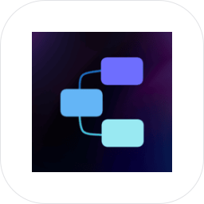&nbsp;&nbsp;</td><td></td><td width="190"></td></tr>
<tr><td width="210">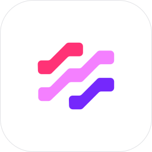&nbsp;&nbsp;</td><td></td><td width="190"></td></tr>
<tr><td width="210">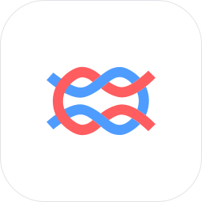&nbsp;&nbsp;</td><td></td><td width="190"></td></tr>
<tr><td width="210">&nbsp;&nbsp;</td><td></td><td width="190"></td></tr>
<tr><td width="210">&nbsp;&nbsp;</td><td></td><td width="190"></td></tr>
<tr><td width="210">&nbsp;&nbsp;</td><td></td><td width="190"></td></tr>
<tr><td width="210">&nbsp;&nbsp;</td><td></td><td width="190"></td></tr>
<tr><td width="210">&nbsp;&nbsp;</td><td></td><td width="190"></td></tr>
<tr><td width="210">&nbsp;&nbsp;</td><td></td><td width="190"></td></tr>
<tr><td colspan="3"> <b>Analytics</b></td></tr>
<tr><td width="210">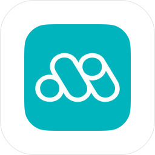&nbsp;&nbsp;</td><td></td><td width="190"></td></tr>
<tr><td width="210">&nbsp;&nbsp;</td><td></td><td width="190"></td></tr>
<tr><td width="210">&nbsp;&nbsp;</td><td></td><td width="190"></td></tr>
<tr><td width="210">&nbsp;&nbsp;</td><td></td><td width="190"></td></tr>
<tr><td width="210">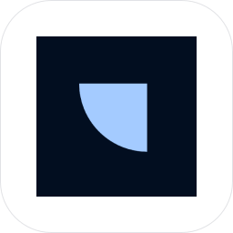&nbsp;&nbsp;</td><td></td><td width="190"></td></tr>
<tr><td width="210">&nbsp;&nbsp;</td><td></td><td width="190"></td></tr>
<tr><td colspan="3"> <b>Auth and Security</b></td></tr>
<tr><td width="210">&nbsp;&nbsp;</td><td></td><td width="190"></td></tr>
<tr><td width="210">&nbsp;&nbsp;</td><td></td><td width="190"></td></tr>
<tr><td width="210">&nbsp;&nbsp;</td><td></td><td width="190"></td></tr>
<tr><td width="210">&nbsp;&nbsp;</td><td></td><td width="190"></td></tr>
<tr><td width="210">&nbsp;&nbsp;</td><td></td><td width="190"></td></tr>
<tr><td width="210">&nbsp;&nbsp;</td><td></td><td width="190"></td></tr>
<tr><td width="210">&nbsp;&nbsp;</td><td></td><td width="190"></td></tr>
<tr><td width="210">&nbsp;&nbsp;</td><td></td><td width="190"></td></tr>
<tr><td colspan="3"> <b>Automation</b></td></tr>
<tr><td width="210">&nbsp;&nbsp;</td><td></td><td width="190"></td></tr>
<tr><td width="210">&nbsp;&nbsp;</td><td></td><td width="190"></td></tr>
<tr><td width="210">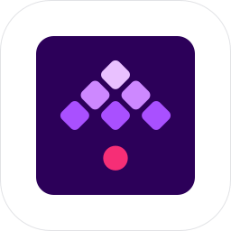&nbsp;&nbsp;</td><td></td><td width="190"></td></tr>
<tr><td width="210">&nbsp;&nbsp;</td><td></td><td width="190"></td></tr>
<tr><td width="210">&nbsp;&nbsp;</td><td></td><td width="190"></td></tr>
<tr><td colspan="3"> <b>Business</b></td></tr>
<tr><td width="210">&nbsp;&nbsp;</td><td></td><td width="190"></td></tr>
<tr><td width="210">&nbsp;&nbsp;</td><td></td><td width="190"></td></tr>
<tr><td width="210">&nbsp;&nbsp;</td><td></td><td width="190"></td></tr>
<tr><td width="210">&nbsp;&nbsp;</td><td></td><td width="190"></td></tr>
<tr><td width="210">&nbsp;&nbsp;</td><td></td><td width="190"></td></tr>
<tr><td width="210">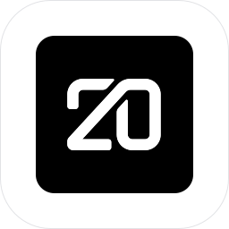&nbsp;&nbsp;</td><td></td><td width="190"></td></tr>
<tr><td colspan="3"> <b>CMS</b></td></tr>
<tr><td width="210">&nbsp;&nbsp;</td><td></td><td width="190"></td></tr>
<tr><td width="210">&nbsp;&nbsp;</td><td></td><td width="190"></td></tr>
<tr><td width="210">&nbsp;&nbsp;</td><td></td><td width="190"></td></tr>
<tr><td width="210">&nbsp;&nbsp;</td><td></td><td width="190"></td></tr>
<tr><td colspan="3"> <b>Commerce</b></td></tr>
<tr><td width="210">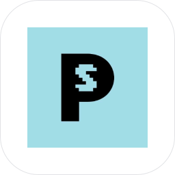&nbsp;&nbsp;</td><td></td><td width="190"></td></tr>
<tr><td width="210">&nbsp;&nbsp;</td><td></td><td width="190"></td></tr>
<tr><td width="210">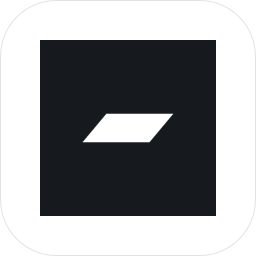&nbsp;&nbsp;</td><td></td><td width="190"></td></tr>
<tr><td colspan="3"> <b>Communication</b></td></tr>
<tr><td width="210">&nbsp;&nbsp;</td><td></td><td width="190"></td></tr>
<tr><td width="210">&nbsp;&nbsp;</td><td></td><td width="190"></td></tr>
<tr><td width="210">&nbsp;&nbsp;</td><td></td><td width="190"></td></tr>
<tr><td colspan="3"> <b>Customer Support</b></td></tr>
<tr><td width="210">&nbsp;&nbsp;</td><td></td><td width="190"></td></tr>
<tr><td width="210">&nbsp;&nbsp;</td><td></td><td width="190"></td></tr>
<tr><td colspan="3"> <b>Developer Tools</b></td></tr>
<tr><td width="210">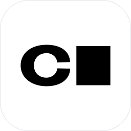&nbsp;&nbsp;</td><td></td><td width="190"></td></tr>
<tr><td width="210">&nbsp;&nbsp;</td><td></td><td width="190"></td></tr>
<tr><td width="210">&nbsp;&nbsp;</td><td></td><td width="190"></td></tr>
<tr><td width="210">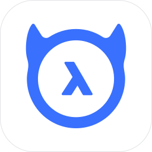&nbsp;&nbsp;</td><td></td><td width="190"></td></tr>
<tr><td width="210">&nbsp;&nbsp;</td><td></td><td width="190"></td></tr>
<tr><td width="210">&nbsp;&nbsp;</td><td></td><td width="190"></td></tr>
<tr><td width="210">&nbsp;&nbsp;</td><td></td><td width="190"></td></tr>
<tr><td width="210">&nbsp;&nbsp;</td><td></td><td width="190"></td></tr>
<tr><td width="210">&nbsp;&nbsp;</td><td></td><td width="190"></td></tr>
<tr><td width="210">&nbsp;&nbsp;</td><td></td><td width="190"></td></tr>
<tr><td colspan="3"> <b>Finance</b></td></tr>
<tr><td width="210">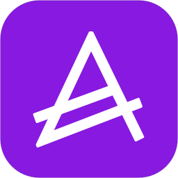&nbsp;&nbsp;</td><td></td><td width="190"></td></tr>
<tr><td width="210">&nbsp;&nbsp;</td><td></td><td width="190"></td></tr>
<tr><td colspan="3"> <b>Low-Code</b></td></tr>
<tr><td width="210">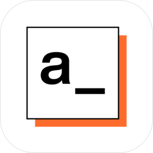&nbsp;&nbsp;</td><td></td><td width="190"></td></tr>
<tr><td width="210">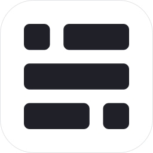&nbsp;&nbsp;</td><td></td><td width="190"></td></tr>
<tr><td width="210">&nbsp;&nbsp;</td><td></td><td width="190"></td></tr>
<tr><td width="210">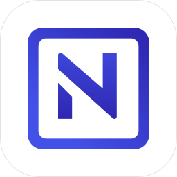&nbsp;&nbsp;</td><td></td><td width="190"></td></tr>
<tr><td width="210">&nbsp;&nbsp;</td><td></td><td width="190"></td></tr>
<tr><td colspan="3"> <b>Marketing</b></td></tr>
<tr><td width="210">&nbsp;&nbsp;</td><td></td><td width="190"></td></tr>
<tr><td width="210">&nbsp;&nbsp;</td><td></td><td width="190"></td></tr>
<tr><td width="210">&nbsp;&nbsp;</td><td></td><td width="190"></td></tr>
<tr><td width="210">&nbsp;&nbsp;</td><td></td><td width="190"></td></tr>
<tr><td colspan="3"> <b>Media</b></td></tr>
<tr><td width="210">&nbsp;&nbsp;</td><td></td><td width="190"></td></tr>
<tr><td width="210">&nbsp;&nbsp;</td><td></td><td width="190"></td></tr>
<tr><td colspan="3"> <b>Monitoring</b></td></tr>
<tr><td width="210">&nbsp;&nbsp;</td><td></td><td width="190"></td></tr>
<tr><td width="210">&nbsp;&nbsp;</td><td></td><td width="190"></td></tr>
<tr><td width="210">&nbsp;&nbsp;</td><td></td><td width="190"></td></tr>
<tr><td width="210">&nbsp;&nbsp;</td><td></td><td width="190"></td></tr>
<tr><td colspan="3"> <b>Productivity</b></td></tr>
<tr><td width="210">&nbsp;&nbsp;</td><td></td><td width="190"></td></tr>
<tr><td width="210">&nbsp;&nbsp;</td><td></td><td width="190"></td></tr>
<tr><td width="210">&nbsp;&nbsp;</td><td></td><td width="190"></td></tr>
<tr><td width="210">&nbsp;&nbsp;</td><td></td><td width="190"></td></tr>
<tr><td width="210">&nbsp;&nbsp;</td><td></td><td width="190"></td></tr>
<tr><td width="210">&nbsp;&nbsp;</td><td></td><td width="190"></td></tr>
<tr><td width="210">&nbsp;&nbsp;</td><td></td><td width="190"></td></tr>
<tr><td width="210">&nbsp;&nbsp;</td><td></td><td width="190"></td></tr>
<tr><td width="210">&nbsp;&nbsp;</td><td></td><td width="190"></td></tr>
<tr><td width="210">&nbsp;&nbsp;</td><td></td><td width="190"></td></tr>
<tr><td width="210">&nbsp;&nbsp;</td><td></td><td width="190"></td></tr>
<tr><td width="210">&nbsp;&nbsp;</td><td></td><td width="190"></td></tr>
<tr><td width="210">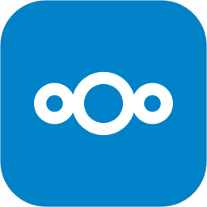&nbsp;&nbsp;</td><td></td><td width="190"></td></tr>
<tr><td width="210">&nbsp;&nbsp;</td><td></td><td width="190"></td></tr>
<tr><td width="210">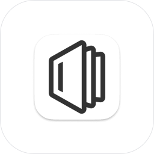&nbsp;&nbsp;</td><td></td><td width="190"></td></tr>
<tr><td width="210">&nbsp;&nbsp;</td><td></td><td width="190"></td></tr>
<tr><td width="210">&nbsp;&nbsp;</td><td></td><td width="190"></td></tr>
<tr><td width="210">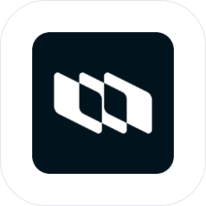&nbsp;&nbsp;</td><td></td><td width="190"></td></tr>
<tr><td width="210">&nbsp;&nbsp;</td><td></td><td width="190"></td></tr>
<tr><td width="210">&nbsp;&nbsp;</td><td></td><td width="190"></td></tr>
<tr><td width="210">&nbsp;&nbsp;</td><td></td><td width="190"></td></tr>
<tr><td width="210">&nbsp;&nbsp;</td><td></td><td width="190"></td></tr>
<tr><td colspan="3"> <b>Search</b></td></tr>
<tr><td width="210">&nbsp;&nbsp;</td><td></td><td width="190"></td></tr>
<tr><td width="210">&nbsp;&nbsp;</td><td></td><td width="190"></td></tr>
</table>

## Adding an App

1. Add `specs/<category>/<app>.yaml` (see the [spec reference](https://github.com/nielsbosma/sliplane-deployer#sliplaneyaml)), with `app.category` set to its folder's title in this README, such as `Developer Tools` for `dev-tools`. The deployer's start page groups apps by it.
2. Check it from a [deployer](https://github.com/nielsbosma/sliplane-deployer) checkout with `node packages/cli/src/bin.ts lint <path to the spec>`.
3. Add its logo to [logos/sources.json](logos/sources.json) and run `node scripts/logos.mjs <app>` (see [logos/README.md](logos/README.md)).
4. Run `node scripts/readme.mjs` to update this list.
